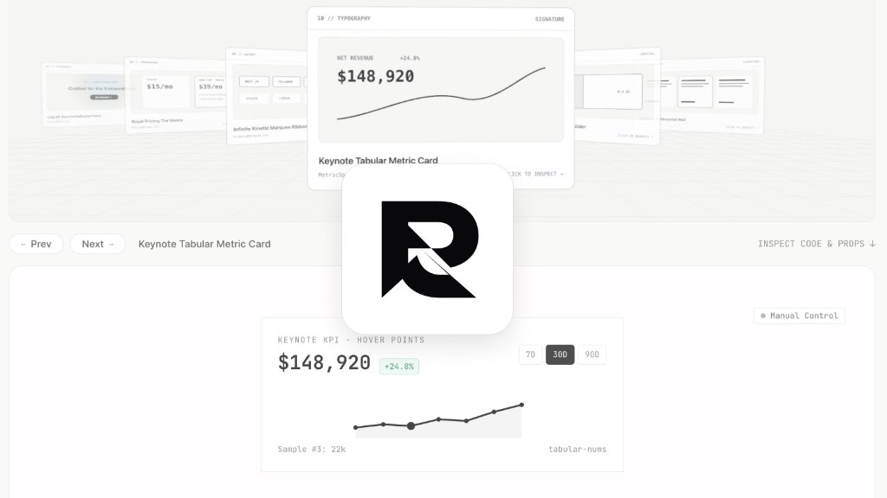

# RenderJet (RJ)



> **Spatial UI Primitives Built for Speed and Precision.**  
> **12 zero-dependency React, Next.js, Tailwind CSS & Vanilla HTML/CSS primitives paired with an interactive Three.js Cover Flow Studio & CLI Installer.**

[](LICENSE)
[](https://www.typescriptlang.org/)
[](package.json)
[](https://jatinsh.netlify.app/)

---

## Why RenderJet?

Most UI libraries look generic. **RenderJet** brings **Apple.com spatial precision**, **Bento asymmetric layouts**, **Linear/Raycast Cmd+K ergonomics**, and **architectural Three.js motion** directly into your codebase with **zero external runtime dependencies**.

- **Copy-Paste or CLI Install:** Own every line of code. Drop clean React + Tailwind `.tsx` files or Vanilla HTML/CSS/JS directly into `./components/rjui/`.
- **Interactive Luxury Studio (`Port 7272`):** Test 3D perspective tilt, cursor-tracked spotlight borders, spring dock magnification, Dynamic Island morphing, and 4 instant theme presets live in your browser.
- **12 Flagship Primitives:** Not bloated with 200 basic buttons—12 signature, high-impact hero, navigation, spatial, and conversion components.

---

## Quickstart

```bash
# Clone and build
git clone https://github.com/raghav1924/monarchui.git
cd monarchui
npm run build

# Launch the Interactive Luxury Studio on http://localhost:7272
./bin/monarchui.js studio

# Initialize Royal Obsidian & Champagne theme tokens in your project
./bin/monarchui.js init --theme royal-obsidian

# Install a React + Tailwind component
./bin/monarchui.js add spotlight-bento

# Or install Vanilla HTML/CSS/JS
./bin/monarchui.js add spatial-dock --vanilla
```

---

## The 12 Royal & Spatial Components

| ID | Component | Tier | Category | Design Highlights |
|---|---|---|---|---|
| `spotlight-bento` | **Royal Spotlight Bento Grid** | Royal | Layout | Cursor-tracked radial spotlight border & frosted bento cells |
| `spatial-dock` | **Apple Spatial Glass Dock** | Spatial | Navigation | macOS spring magnification dock with floating tooltips |
| `kinetic-card-3d` | **Kinetic 3D Perspective Card** | Royal | Spatial | Real-time 3D `rotateX`/`rotateY` tilt with specular sheen |
| `command-palette` | **Command-K Spotlight Palette** | Signature | Navigation | Raycast/Linear `Cmd+K` launcher with instant fuzzy search |
| `champagne-button` | **Royal Champagne Magnetic CTA** | Royal | Conversion | Cursor-attracted magnetic pull + gold shimmer aura |
| `dynamic-island` | **Dynamic Island Status Pill** | Spatial | Feedback | Cupertino-style morphing pill with spring expansion |
| `aurora-hero` | **Liquid Aurora Editorial Hero** | Royal | Typography | Diffused aurora mesh backdrop + editorial headline lockup |
| `pricing-crown` | **Royal Pricing Tier Matrix** | Royal | Conversion | Highlighted Crown tier + annual/monthly toggle |
| `kinetic-marquee` | **Infinite Kinetic Marquee Ribbon** | Signature | Layout | GPU-accelerated dual track with alpha edge masks |
| `metric-sparkline` | **Keynote Tabular Metric Card** | Signature | Typography | Tabular-nums KPI figure + SVG bezier sparkline |
| `split-compare` | **Tactile Split Comparison Slider** | Spatial | Spatial | Draggable glass divider for before/after UI comparisons |
| `founder-wall` | **Editorial Testimonial Wall** | Signature | Typography | Staggered luxury proof cards with verified badges |

---

## 4 Built-In Luxury Themes

- `royal-obsidian` — **Royal Obsidian & Champagne** (`#050507` + `#e5c158`)
- `apple-frost` — **Apple Spatial Frost** (`#f5f5f7` + `#0071e3`)
- `cyber-amethyst` — **Cyber Amethyst & Cyan** (`#07090e` + `#a855f7`)
- `swiss-editorial` — **Swiss Editorial Monochrome** (`#0a0a0a` + `#ef4444`)

---

## License

MIT License. Crafted by **[Jatin Sharma](https://jatinsh.netlify.app/)**.  
If MonarchUI elevates your frontend, **star ⭐ and fork 🍴 the repository**!
