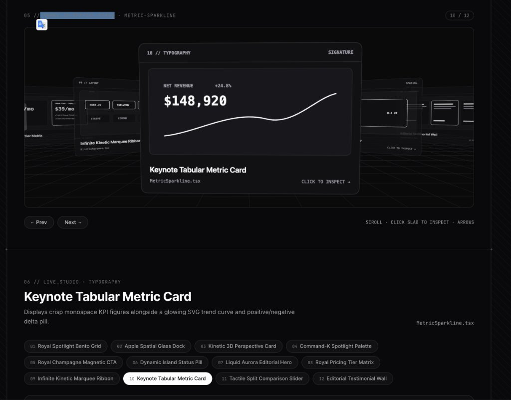
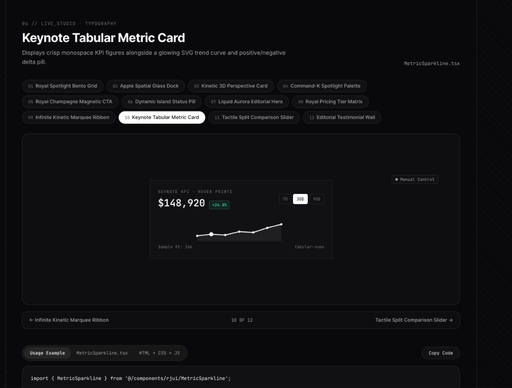

# RenderJet (RJ)


> **Spatial UI Primitives Built for Speed and Precision.**  
> **12 zero-dependency React, Next.js, Tailwind CSS & Vanilla HTML/CSS primitives paired with an interactive Three.js Cover Flow Studio & CLI Installer.**

[](LICENSE)
[](https://www.typescriptlang.org/)
[](package.json)
[](https://jatinsh.netlify.app/)

---

## Screenshots

| Three.js Spatial Cover Flow Stage | Live Interactive Preview & Code Studio |
| :---: | :---: |
|  |  |
---

## Why RenderJet?

Most UI libraries look generic. **RenderJet** brings **Apple.com spatial precision**, **Bento asymmetric layouts**, **Linear/Raycast Cmd+K ergonomics**, and **architectural Three.js motion** directly into your codebase with **zero external runtime dependencies**.

- **Copy-Paste or CLI Install:** Own every line of code. Drop clean React + Tailwind `.tsx` files or Vanilla HTML/CSS/JS directly into `./components/rjui/`.
- **Interactive Studio (`Port 7272`):** Browse all 12 primitives on a Three.js Cover Flow stage with an Auto-Demo virtual cursor, live interactive previews, and instant code inspection.
- **12 Flagship Primitives:** Focused, high-impact hero, navigation, spatial, feedback, and conversion components.

---

## Installation & Running Locally

### 1. Clone & Install

```bash
git clone https://github.com/raghav1924/renderjet.git
cd renderjet
npm install
```

### 2. Run the Next.js Interactive Studio

```bash
npm run dev
```

Open **[http://localhost:7272](http://localhost:7272)** in your browser.

### 3. Build & Run Tests

```bash
# Type-check Next.js app
./node_modules/.bin/tsc --noEmit

# Build CLI & run test suite
npm test

# Production Next.js build
npm run build
npm start
```

---

## How to Use It

### CLI Usage (`rjui`)

```bash
# List all 12 components
npx rjui list

# Initialize theme tokens (rjui-tokens.css & rjui.tailwind.ts)
npx rjui init --theme royal-obsidian

# Install a React + Tailwind component into ./components/rjui/
npx rjui add spotlight-bento

# Or install Vanilla HTML/CSS/JS
npx rjui add spatial-dock --vanilla

# Install all 12 components at once
npx rjui add all

# Launch the standalone Studio server on port 7272
npx rjui studio
```

### React Usage Example

After running `npx rjui add spotlight-bento`, import and render the component directly:

```tsx
import { SpotlightBento } from '@/components/rjui/SpotlightBento';

export default function FeaturesSection() {
  return (
    <SpotlightBento
      spotlightColor="rgba(229, 193, 88, 0.22)"
      items={[
        {
          title: 'Zero-Dependency Core',
          description: 'Clean TypeScript primitives you own in your repo.',
          badge: 'Architecture',
          colSpan: 'md:col-span-8'
        },
        {
          title: '60fps Physics',
          description: 'GPU-accelerated pointer transforms.',
          badge: 'Motion',
          colSpan: 'md:col-span-4'
        }
      ]}
    />
  );
}
```

### Keyboard Shortcuts in the Studio

- `←` / `→` — Step through the 12 components in the 3D Cover Flow stage
- `⌘K` / `Ctrl+K` — Open the quick-jump search palette
- **Horizontal Scroll / Click** — Focus any 3D slab or click the active slab to inspect its code & props

---

## The 12 Spatial & Architectural Components

| ID | Component | Tier | Category | Design Highlights |
|---|---|---|---|---|
| `spotlight-bento` | **Royal Spotlight Bento Grid** | Royal | Layout | Cursor-tracked radial spotlight border & frosted bento cells |
| `spatial-dock` | **Apple Spatial Glass Dock** | Spatial | Navigation | macOS spring magnification dock with floating tooltips |
| `kinetic-card-3d` | **Kinetic 3D Perspective Card** | Royal | Spatial | Real-time 3D `rotateX`/`rotateY` tilt with specular sheen |
| `command-palette` | **Command-K Spotlight Palette** | Signature | Navigation | Raycast/Linear `Cmd+K` launcher with instant fuzzy search |
| `champagne-button` | **Royal Champagne Magnetic CTA** | Royal | Conversion | Cursor-attracted magnetic pull + gold shimmer aura |
| `dynamic-island` | **Dynamic Island Status Pill** | Spatial | Feedback | Cupertino-style morphing pill with spring expansion |
| `aurora-hero` | **Liquid Aurora Editorial Hero** | Royal | Typography | Diffused aurora mesh backdrop + editorial headline lockup |
| `pricing-crown` | **Royal Pricing Tier Matrix** | Royal | Conversion | Highlighted Crown tier + annual/monthly toggle |
| `kinetic-marquee` | **Infinite Kinetic Marquee Ribbon** | Signature | Layout | GPU-accelerated dual track with alpha edge masks |
| `metric-sparkline` | **Keynote Tabular Metric Card** | Signature | Typography | Tabular-nums KPI figure + SVG bezier sparkline |
| `split-compare` | **Tactile Split Comparison Slider** | Spatial | Spatial | Draggable glass divider for before/after UI comparisons |
| `founder-wall` | **Editorial Testimonial Wall** | Signature | Typography | Staggered luxury proof cards with verified badges |

---

## 4 Built-In Themes

- `royal-obsidian` — **Royal Obsidian & Champagne** (`#050507` + `#e5c158`)
- `apple-frost` — **Apple Spatial Frost** (`#f5f5f7` + `#0071e3`)
- `cyber-amethyst` — **Cyber Amethyst & Cyan** (`#07090e` + `#a855f7`)
- `swiss-editorial` — **Swiss Editorial Monochrome** (`#0a0a0a` + `#ef4444`)

---

## License

MIT License. Crafted by **[Jatin Sharma](https://jatinsh.netlify.app/)**.  
If **RenderJet** elevates your frontend, **star ⭐ and fork 🍴 the repository**!
